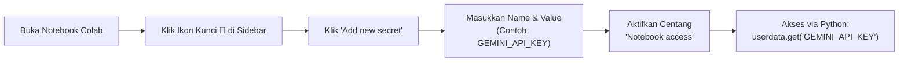

# Panduan Lengkap Konfigurasi Kredensial & API Key (Azure & Alternatif)

Panduan ini menjelaskan langkah demi langkah cara memperoleh, mengonfigurasi, dan mengamankan API Key serta Endpoint untuk seluruh modul praktik **AI-901**, baik untuk layanan resmi **Microsoft Azure** maupun **Penyedia Alternatif (Google Gemini, OpenAI, dan Tanpa API Key)**.

---

## 📑 Daftar Isi
1. [Konfigurasi Kredensial Microsoft Azure AI](#1-konfigurasi-kredensial-microsoft-azure-ai)
   - [Azure AI Foundry Project & Deployments](#a-azure-ai-foundry-project--deployments)
   - [Azure AI Speech Service](#b-azure-ai-speech-service)
   - [Azure AI Content Understanding](#c-azure-ai-content-understanding)
2. [Konfigurasi Kredensial Model Alternatif](#2-konfigurasi-kredensial-model-alternatif)
   - [Google Gemini API (Free Tier - 0 Rupiah)](#a-google-gemini-api-free-tier---rekomendasi)
   - [OpenAI Developer Platform](#b-openai-developer-platform)
   - [Ollama (100% Offline / Tanpa API Key)](#c-ollama-offline---tanpa-api-key)
3. [Cara Pasang Kredensial di Komputer Lokal (.env)](#3-cara-pasang-kredensial-di-komputer-lokal-env)
4. [Cara Pasang Kredensial di Google Colab (Colab Secrets)](#4-cara-pasang-kredensial-di-google-colab-colab-secrets)

---

## 1. Konfigurasi Kredensial Microsoft Azure AI

### A. Azure AI Foundry Project & Deployments
Digunakan oleh: `01_chat_client.py`, `02_agent_client.py`, `03_text_analysis.py`, dan `05_vision.py`.

1. Buka portal [Azure AI Foundry](https://ai.azure.com/) dan masuk menggunakan akun Azure Anda.
2. Buat atau pilih **Project** yang telah ada.
3. Di halaman **Overview / Project Settings**, salin **Project Endpoint**:
   ```env
   AZURE_AI_PROJECT_ENDPOINT=https://<resource-name>.services.ai.azure.com/api/projects/<project-name>
   ```
4. Masuk ke menu **Deployments** di bilah navigasi kiri:
   - Klik **Deploy model** $\rightarrow$ **Deploy base model**.
   - Pilih `gpt-4o-mini` untuk teks/chat dan multimodal. Catat nama deployment-nya:
     ```env
     AZURE_AI_CHAT_DEPLOYMENT=gpt-4o-mini
     AZURE_AI_VISION_DEPLOYMENT=gpt-4o-mini
     ```
   - (Opsional) Deploy model gambar seperti `dall-e-3`:
     ```env
     AZURE_AI_IMAGE_DEPLOYMENT=dall-e-3
     ```
5. Untuk Agen AI (`02_agent_client.py`), buat agen di menu **Agents** dan catat namanya:
   ```env
   AZURE_AI_AGENT_NAME=asisten-pendaftaran
   ```

---

### B. Azure AI Speech Service
Digunakan oleh: `04_speech.py`.

1. Masuk ke [Azure Portal](https://portal.azure.com/).
2. Di kolom pencarian atas, ketik **Speech Services**, lalu klik **Create**.
3. Pilih Subscription, Resource Group, dan Region terdekat (contoh: `Southeast Asia` / `East US`).
4. Setelah proses deployment selesai, klik **Go to resource**.
5. Buka menu **Keys and Endpoint** di bilah sisi kiri:
   - Salin **Key 1**:
     ```env
     AZURE_SPEECH_KEY=a1b2c3d4e5f6g7h8i9j0...
     ```
   - Catat **Location/Region** (huruf kecil semua tanpa spasi):
     ```env
     AZURE_SPEECH_REGION=southeastasia
     ```

---

### C. Azure AI Content Understanding
Digunakan oleh: `06_content_understanding.py`.

1. Di [Azure Portal](https://portal.azure.com/), cari layanan **Content Understanding** atau **Azure AI Services (Multi-service)**.
2. Buat resource baru di region yang mendukung fitur Content Understanding (contoh: `East US` atau `West Europe`).
3. Masuk ke menu **Keys and Endpoint**:
   - Salin **Endpoint**:
     ```env
     CU_ENDPOINT=https://<resource-name>.cognitiveservices.azure.com
     ```
   - Salin **Key 1**:
     ```env
     CU_KEY=9a8b7c6d5e4f3a2b1...
     ```

---

## 2. Konfigurasi Kredensial Model Alternatif

Jika Anda tidak memiliki langganan Azure atau kredit Azure telah habis, gunakan alternatif berikut:

### A. Google Gemini API (Free Tier - Rekomendasi)
*Mendukung chat, multimodal vision, function calling, dan JSON mode secara gratis tanpa kartu kredit.*

1. Kunjungi [Google AI Studio](https://aistudio.google.com/app/apikey).
2. Masuk menggunakan akun Google biasa.
3. Klik tombol **Get API key** $\rightarrow$ **Create API key**.
4. Pilih project Google Cloud (atau buat baru secara otomatis dalam 1 klik).
5. Salin kunci API yang diawali dengan `AIzaSy...`:
   ```env
   AI_PROVIDER=gemini
   GEMINI_API_KEY=AIzaSyB...
   GEMINI_CHAT_MODEL=gemini-1.5-flash
   GEMINI_VISION_MODEL=gemini-1.5-flash
   ```

---

### B. OpenAI Developer Platform
1. Kunjungi [OpenAI API Keys](https://platform.openai.com/api-keys).
2. Klik **Create new secret key**, beri nama, lalu salin kunci yang diawali dengan `sk-proj-...` atau `sk-...`.
3. Atur di konfigurasi:
   ```env
   AI_PROVIDER=openai
   OPENAI_API_KEY=sk-proj-...
   OPENAI_CHAT_MODEL=gpt-4o-mini
   OPENAI_VISION_MODEL=gpt-4o-mini
   ```

---

### C. Ollama (Offline - Tanpa API Key)
1. Unduh aplikasi Ollama dari [https://ollama.com](https://ollama.com).
2. Buka terminal di laptop Anda dan jalankan model:
   ```bash
   ollama run llama3.2
   ollama run llava       # untuk multimodal vision
   ```
3. Atur di konfigurasi (Ollama tidak membutuhkan API key valid):
   ```env
   AI_PROVIDER=ollama
   OLLAMA_BASE_URL=http://localhost:11434/v1
   OLLAMA_CHAT_MODEL=llama3.2
   OLLAMA_VISION_MODEL=llava
   ```

---

## 3. Cara Pasang Kredensial di Komputer Lokal (.env)

1. Salin template `.env.example` menjadi `.env`:
   - **Windows:**
     ```powershell
     copy .env.example .env
     ```
   - **Linux / macOS:**
     ```bash
     cp .env.example .env
     ```
2. Buka file `.env` menggunakan teks editor (VS Code, Notepad, dsb).
3. Hapus placeholder tanda kurung `<...>` dan masukkan kunci asli Anda.
4. **Keamanan:** File `.env` sudah terdaftar di `.gitignore`. Jangan pernah mengunggah file `.env` ke GitHub publik.

---

## 4. Cara Pasang Kredensial di Google Colab (Colab Secrets)

Google Colab menyediakan fitur **Secrets Management** (ikon kunci 🔑 di sidebar kiri) agar kunci API tidak terekspos di dalam sel kode notebook.



### Langkah-langkah di Colab:
1. Di bilah menu kiri Google Colab, klik ikon **Secrets** (berbentuk kunci 🔑).
2. Klik **Add new secret**.
3. Masukkan nama rahasia dan nilainya:
   - `GEMINI_API_KEY` : `AIzaSy...`
   - `AZURE_AI_PROJECT_ENDPOINT` : `https://...`
   - `AZURE_SPEECH_KEY` : `a1b2c3...`
4. Aktifkan sakelar **Notebook access** pada setiap rahasia yang ditambahkan.
5. Di dalam kode Python Colab, panggil dengan:
   ```python
   from google.colab import userdata
   import os

   gemini_key = userdata.get('GEMINI_API_KEY')
   os.environ["GEMINI_API_KEY"] = gemini_key
   ```
