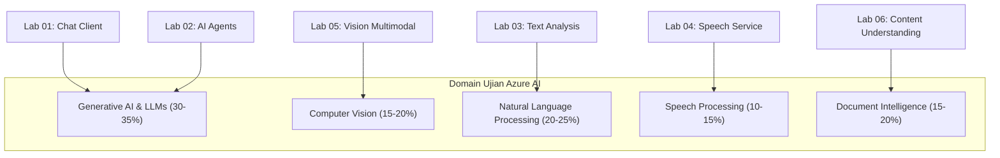

# Panduan Lengkap Materi & Kisi-Kisi Ujian Sertifikasi AI (AI-900 / AI-102 / AI-901)

Dokumen ini membedah seluruh konsep teknis dari **Lab 01 hingga Lab 06** yang wajib dipahami untuk menghadapi ujian sertifikasi resmi Microsoft Azure AI (seperti **AI-900: Microsoft Azure AI Fundamentals** dan **AI-102: Designing and Implementing a Microsoft Azure AI Solution**).

---

## 📑 Daftar Isi
1. [Peta Konsep & Bobot Ujian Berdasarkan Lab](#1-peta-konsep--bobot-ujian-berdasarkan-lab)
2. [Bedah Materi Detail Setiap Lab](#2-bedah-materi-detail-setiap-lab)
   - [Lab 01: Chat Client & Hyperparameter LLM](#lab-01-chat-client--hyperparameter-llm)
   - [Lab 02: AI Agent Service & Tool Orchestration](#lab-02-ai-agent-service--tool-orchestration)
   - [Lab 03: Text Analysis, NLP, & JSON Structured Output](#lab-03-text-analysis-nlp--json-structured-output)
   - [Lab 04: Speech AI (TTS, STT, & SSML)](#lab-04-speech-ai-tts-stt--ssml)
   - [Lab 05: Computer Vision & Multimodal](#lab-05-computer-vision--multimodal)
   - [Lab 06: Content Understanding & Asynchronous REST](#lab-06-content-understanding--asynchronous-rest)
3. [Tabel Parameter & Kode HTTP Penting (Wajib Hafal)](#3-tabel-parameter--kode-http-penting-wajib-hafal)
4. [Simulasi Soal Ujian Riil & Pembahasan](#4-simulasi-soal-ujian-riil--pembahasan)

---

## 1. Peta Konsep & Bobot Ujian Berdasarkan Lab



---

## 2. Bedah Materi Detail Setiap Lab

### Lab 01: Chat Client & Hyperparameter LLM
*File Praktik:* [`01_chat_client.py`](file:///c:/Users/ikhwa/Downloads/kode_praktik_AI901/kode_praktik_AI901/01_chat_client.py)

#### Konsep Kunci:
1. **Stateless Nature of LLMs:**
   * LLM tidak memiliki ingatan bawaan antar panggilan API. Agar percakapan tersambung (*multi-turn*), klien wajib menyertakan riwayat array `messages` lengkap yang berisi pesan-pesan sebelumnya.
2. **Peran Pesan (Roles):**
   * `system`: Instruksi utama yang memandu perilaku, nada, dan batasan (*guardrails*) model.
   * `user`: Pertanyaan atau input dari pengguna.
   * `assistant`: Jawaban yang dihasilkan oleh model pada turn sebelumnya.
3. **Hyperparameter Inferensi:**
   * **`temperature` (Rentang 0.0 – 2.0):**
     * Nilai **rendah (0.0 – 0.2)**: Deterministik, faktual, konsisten. Digunakan untuk perbankan, kepatuhan hukum, matematika, dan ekstraksi data.
     * Nilai **tinggi (0.7 – 1.0+)**: Kreatif, variatif, imajinatif. Digunakan untuk *brainstorming*, penulisan puisi, dan ide marketing.
   * **`top_p` (Nucleus Sampling):** Mengontrol probabilitas kumulatif token yang dipertimbangkan. *Aturan praktis ujian: Jangan ubah `temperature` dan `top_p` sekaligus, ubah salah satu saja.*
   * **`max_tokens`:** Batas maksimum panjang token yang boleh digenerate model untuk satu kali respons.

---

### Lab 02: AI Agent Service & Tool Orchestration
*File Praktik:* [`02_agent_client.py`](file:///c:/Users/ikhwa/Downloads/kode_praktik_AI901/kode_praktik_AI901/02_agent_client.py) / [`alternatif/02_agent_alt.py`](file:///c:/Users/ikhwa/Downloads/kode_praktik_AI901/kode_praktik_AI901/alternatif/02_agent_alt.py)

#### Konsep Kunci:
1. **Perbedaan Chat Completion vs AI Agent:**
   * Chat Completion hanya merespons teks secara pasif.
   * AI Agent memiliki kemampuan **otonom**: dapat merencanakan langkah (*planning*), memiliki memori persisten di cloud, memanggil alat eksternal (*tools/function calling*), dan mengakses basis data (*knowledge grounding*).
2. **Mekanisme Function Calling (Tool Calling):**
   * **PENTING DI UJIAN:** Model AI **TIDAK mengeksekusi kode Python secara langsung**.
   * Model hanya **menghasilkan nama fungsi dan argumen JSON** yang perlu dipanggil.
   * Aplikasi klien Anda yang mengeksekusi fungsi tersebut secara lokal, lalu mengirimkan hasilnya kembali ke model agar model menyusun jawaban akhir.
3. **Grounding & RAG (Retrieval-Augmented Generation):**
   * Mengintegrasikan data perusahaan pribadi (PDF, database SQL) ke prompt model untuk mencegah halusinasi (*grounded response*).

---

### Lab 03: Text Analysis, NLP, & JSON Structured Output
*File Praktik:* [`03_text_analysis.py`](file:///c:/Users/ikhwa/Downloads/kode_praktik_AI901/kode_praktik_AI901/03_text_analysis.py)

#### Konsep Kunci:
1. **Analisis Sentimen (Sentiment Analysis):**
   * Mengembalikan sentimen: `positive`, `negative`, `neutral`, atau `mixed`.
   * Disertai skor keyakinan (*confidence score*) antara `0.0` sampai `1.0`.
2. **Named Entity Recognition (NER):**
   * Mengidentifikasi entitas penting dalam teks:
     * `Person` (Nama orang), `Location` (Kota, negara), `Organization` (Perusahaan), `DateTime` (Tanggal/waktu), `Quantity` (Angka/ukuran).
3. **Key Phrase Extraction:**
   * Mengidentifikasi frasa-frasa utama yang mencerminkan inti pembicaraan.
4. **Structured Outputs (JSON Mode):**
   * Parameter `response_format={"type": "json_object"}`.
   * Menjamin bahwa respons LLM selalu valid secara sintaksis JSON tanpa karakter pembungkus markdown tambahan (` ```json `), sehingga aman langsung diproses oleh `json.loads()`.

---

### Lab 04: Speech AI (TTS, STT, & SSML)
*File Praktik:* [`04_speech.py`](file:///c:/Users/ikhwa/Downloads/kode_praktik_AI901/kode_praktik_AI901/04_speech.py)

#### Konsep Kunci:
1. **Speech Synthesis (Text-to-Speech / TTS):**
   * Mengubah teks string menjadi suara manusia digital.
   * **Neural Voices:** Suara generasi modern berbasis deep learning yang memiliki intonasi sangat mirip manusia asli (contoh: `id-ID-ArdiNeural`, `id-ID-GadisNeural`).
2. **Speech Recognition (Speech-to-Text / STT):**
   * Mentranskripsikan audio rekaman atau mikrofon ke dalam teks alfabetis.
3. **SSML (Speech Synthesis Markup Language):**
   * Format XML standar untuk mengontrol ekspresi suara:
     * `<speak>`: Elemen pembungkus utama.
     * `<voice name="...">`: Memilih karakter pengisi suara.
     * `<prosody rate="..." pitch="...">`: Mengatur kecepatan berbicara dan nada suara.
     * `<break time="500ms"/>`: Menyisipkan jeda keheningan.
     * `<emphasis level="strong">`: Memberikan penekanan suara pada kata tertentu.

---

### Lab 05: Computer Vision & Multimodal
*File Praktik:* [`05_vision.py`](file:///c:/Users/ikhwa/Downloads/kode_praktik_AI901/kode_praktik_AI901/05_vision.py)

#### Konsep Kunci:
1. **Image Analysis vs Image Generation:**
   * **Image Analysis (Vision LLM / Multimodal):** Input berupa *Gambar + Pertanyaan*, output berupa *Teks deskripsi*.
   * **Image Generation (DALL-E):** Input berupa *Prompt teks*, output berupa *Gambar visual baru*.
2. **Metode Pengiriman Gambar ke API:**
   * **Public URL:** Mengirimkan tautan HTTP/HTTPS gambar yang dapat diakses publik.
   * **Base64 Encoding:** Mengonversi byte gambar lokal menjadi string biner `data:image/jpeg;base64,...`. Digunakan saat gambar berada di server internal privat tanpa akses internet publik.
3. **Fitur Computer Vision Tradisional:**
   * **Image Tagging:** Mengembalikan daftar label kata benda terkait isi gambar.
   * **Object Detection:** Mendeteksi objek beserta koordinat lokasinya dalam format *Bounding Box* (`[x, y, w, h]`).
   * **Optical Character Recognition (OCR):** Membaca teks cetak maupun tulisan tangan dari gambar.

---

### Lab 06: Content Understanding & Asynchronous REST
*File Praktik:* [`06_content_understanding.py`](file:///c:/Users/ikhwa/Downloads/kode_praktik_AI901/kode_praktik_AI901/06_content_understanding.py)

#### Konsep Kunci:
1. **Prebuilt Analyzers:**
   * Model terlatih siap pakai tanpa perlu melatih data sendiri:
     * `prebuilt-invoice`: Faktur tagihan komersial.
     * `prebuilt-receipt`: Struk kasir/restoran.
     * `prebuilt-idDocument`: Paspor, KTP, SIM.
2. **Pola Asynchronous REST Polling (SANGAT SERING DI UJIAN):**
   * Karena dokumen PDF berukuran besar membutuhkan waktu analisis beberapa detik hingga menit:
     * Langkah 1: Klien melakukan `POST /analyzers/{id}:analyze` dengan membawa file dokumen.
     * Langkah 2: Server merespons dengan kode **`HTTP 202 Accepted`** dan menyertakan URL pelacak pada response header bernama **`Operation-Location`**.
     * Langkah 3: Klien melakukan `GET` berulang kali ke URL `Operation-Location` sampai nilai `status` menjadi `"succeeded"`.

---

## 3. Tabel Parameter & Kode HTTP Penting (Wajib Hafal)

| Parameter / Istilah | Rentang / Nilai | Fungsi / Makna Ujian |
|---|---|---|
| **`temperature = 0.0`** | 0.0 s.d. 2.0 | Jawaban deterministik, faktual, tanpa variasi acak (ekstraksi data/keuangan). |
| **`temperature = 1.0`** | 0.0 s.d. 2.0 | Jawaban kreatif, beragam (marketing, penulisan konten). |
| **`HTTP 202 Accepted`** | Kode Status HTTP | Permintaan analisis dokumen diterima dan sedang diproses di latar belakang secara asynchronous. |
| **`Operation-Location`** | Header Respon HTTP | URL target yang harus di-poll oleh klien untuk memantau status pekerjaan asynchronous. |
| **`HTTP 429 Too Many Requests`** | Kode Status HTTP | Rate limit / kuota token per menit (TPM) terlampaui. Klien harus menunggu sesuai header `Retry-After`. |
| **`response_format: {"type": "json_object"}`** | Konfigurasi Model | Memaksa LLM mengembalikan format JSON murni. |
| **`SSML`** | Standar XML | Bahasa markup untuk mengatur nada, kecepatan, jeda, dan emosi suara sintesis. |
| **`Bounding Box`** | `[x, y, width, height]` | Koordinat posisi objek yang terdeteksi pada citra gambar. |

---

## 4. Simulasi Soal Ujian Riil & Pembahasan

### Soal 1 (Conversational AI - Parameter Tuning)
**Pertanyaan:**  
Perusahaan farmasi sedang mengembangkan asisten AI untuk memberikan informasi dosis obat kepada tenaga medis. Respon harus selalu konsisten dengan literatur medis dan tidak boleh menyimpang. Tindakan apa yang harus dilakukan pengembang?  
* A. Menaikkan `temperature` menjadi 1.5 dan menaikkan `top_p`.  
* B. Menurunkan `temperature` mendekati 0.0 dan memberikan instruksi ketat pada `system message`.  
* C. Mengubah `role` pesan pengguna menjadi `assistant`.  
* D. Menggunakan model DALL-E 3 dengan skema JSON.  
> 👉 **Kunci Jawaban:** **B**  
> **Pembahasan:** Nilai `temperature` rendah meminimalkan variasi acak dan halusinasi. `system message` memastikan batasan keselamatan (*guardrails*) dipatuhi model.

---

### Soal 2 (Content Understanding - Asynchronous REST API)
**Pertanyaan:**  
Aplikasi Anda mengirimkan file PDF 50 halaman ke Azure AI Content Understanding menggunakan metode REST POST. Server mengembalikan respon dengan kode status `HTTP 202 Accepted`. Apa yang harus dilakukan aplikasi klien berikutnya untuk memperoleh hasil ekstraksi?  
* A. Mengirimkan ulang file dokumen dengan metode HTTP PUT.  
* B. Mengambil URL dari response header `Operation-Location` dan melakukan permintaan HTTP GET secara berkala hingga status `succeeded`.  
* C. Membaca body response HTTP 202 karena seluruh teks dokumen sudah dimuat di sana.  
* D. Mengubah Content-Type menjadi `application/pdf` dan mengulangi POST.  
> 👉 **Kunci Jawaban:** **B**  
> **Pembahasan:** HTTP 202 menandakan proses asinkron sedang berjalan. URL pelacakan selalu diletakkan Azure pada header `Operation-Location`.

---

### Soal 3 (Speech Processing - SSML)
**Pertanyaan:**  
Anda menggunakan Azure AI Speech Synthesizer untuk membaca instruksi darurat di pabrik. Anda ingin menyisipkan jeda hening selama 2 detik sebelum kata kunci peringatan dibacakan. Bagaimana cara mengonfigurasinya?  
* A. Menambahkan tanda koma yang banyak pada teks string.  
* B. Menggunakan format SSML dengan tag `<break time="2000ms"/>`.  
* C. Menurunkan nilai parameter `max_tokens` pada SpeechConfig.  
* D. Menggunakan SpeechRecognizer dengan mode ContinuousRecognition.  
> 👉 **Kunci Jawaban:** **B**  
> **Pembahasan:** SSML adalah standar XML resmi untuk kustomisasi audio sintesis, di mana tag `<break time="..."/>` digunakan untuk jeda waktu spesifik.

---

### Soal 4 (AI Agents - Function Calling)
**Pertanyaan:**  
Saat membangun AI Agent dengan kapabilitas *Tool Calling*, kapankah kode fungsi Python pada server lokal dijalankan?  
* A. Dijalankan langsung di dalam cluster server Azure OpenAI saat prompt diproses.  
* B. Dijalankan oleh aplikasi klien setelah menerima objek respons dari LLM yang berisi `tool_calls`.  
* C. Dijalankan sebelum prompt dikirimkan ke model AI.  
* D. Dijalankan secara otomatis oleh compiler browser pengguna.  
> 👉 **Kunci Jawaban:** **B**  
> **Pembahasan:** Model LLM hanya berfungsi sebagai perencana (*brain*). LLM mengeluarkan struktur nama dan parameter fungsi, lalu aplikasi klien lokal yang mengeksekusi fungsi dan mengirimkan hasilnya kembali ke LLM.

---

### Soal 5 (NLP & Text Analysis - NER)
**Pertanyaan:**  
Sebuah aplikasi e-commerce ingin otomatis mengelompokkan keluhan pembeli: mendeteksi nama produk yang rusak, cabang kota pengiriman, dan tanggal komplain. Layanan AI apa yang paling tepat digunakan?  
* A. Key Phrase Extraction  
* B. Named Entity Recognition (NER)  
* C. Text-to-Speech Synthesis  
* D. Image Classification  
> 👉 **Kunci Jawaban:** **B**  
> **Pembahasan:** NER secara spesifik dirancang untuk mengenali dan mengklasifikasikan entitas bernama seperti Produk, Lokasi (Kota), dan DateTime (Tanggal).
