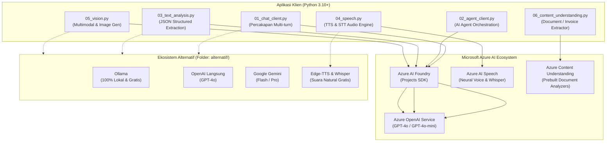

# Repositori Praktik Azure AI & Model Alternatif (AI-901)

[](https://ai.azure.com/)
[](https://www.python.org/)
[](LICENSE)
[](https://platform.openai.com/)

Repositori ini berisi implementasi kode praktik standar untuk kurikulum **AI-901 (Applied Artificial Intelligence & Azure AI Solutions)** yang mengacu pada best-practice dari [Azure-Samples](https://github.com/Azure-Samples).

Seluruh modul dirancang secara **global**, modular, dan siap pakai—tanpa pengikatan sesi pelatihan tertentu. Repositori ini juga dilengkapi dengan **implementasi model alternatif (Ollama lokal gratis, OpenAI direct, Google Gemini)** bagi peserta yang ingin belajar tanpa ketergantungan kuota Azure.

---

## 📑 Daftar Isi

- [Arsitektur & Peta Modul](#-arsitektur--peta-modul)
- [Struktur Direktori](#-struktur-direktori)
- [Panduan Setup Virtual Environment (venv)](#-panduan-setup-virtual-environment-venv)
- [Konfigurasi Environment (.env)](#-konfigurasi-environment-env)
- [Panduan Modul Praktik Utama (Azure AI)](#-panduan-modul-praktik-utama-azure-ai)
  - [Modul 01: Chat Client Interaktif](#modul-01-chat-client-interaktif-01_chat_clientpy)
  - [Modul 02: Azure AI Agent Service Client](#modul-02-azure-ai-agent-service-client-02_agent_clientpy)
  - [Modul 03: Analisis Teks Berstruktur (JSON Mode)](#modul-03-analisis-teks-berstruktur-03_text_analysispy)
  - [Modul 04: Layanan Suara (Speech-to-Text & Text-to-Speech)](#modul-04-layanan-suara-speech-04_speechpy)
  - [Modul 05: Computer Vision Multimodal](#modul-05-computer-vision-multimodal-05_visionpy)
  - [Modul 06: Azure Content Understanding](#modul-06-azure-content-understanding-06_content_understandingpy)
- [Alternatif Model AI Lainnya (Ollama, OpenAI, Gemini)](#-alternatif-model-ai-lainnya-ollama-openai-gemini)
- [Praktik Terbaik & Manajemen Biaya](#-praktik-terbaik--manajemen-biaya)

---

## 🏛️ Arsitektur & Peta Modul



---

## 📂 Struktur Direktori

```text
kode_praktik_AI901/
├── 01_chat_client.py           # Chat client interaktif multi-turn
├── 02_agent_client.py          # Pemanggilan Azure AI Agent Service
├── 03_text_analysis.py         # Analisis teks berstruktur (JSON Mode)
├── 04_speech.py                # Layanan suara (TTS & STT Azure Speech)
├── 05_vision.py                # Vision Multimodal & Text-to-Image
├── 06_content_understanding.py # Azure Content Understanding REST API
├── common.py                   # Helper autentikasi & inisialisasi Azure client
├── requirements.txt            # Dependensi paket Python utama
├── .env.example                # Template konfigurasi environment Azure
├── data/
│   ├── ulasan.txt              # Dataset teks ulasan untuk analisis
│   └── rak.jpg                 # Contoh foto rak untuk pengujian multimodal
├── output/                     # Direktori hasil eksekusi (JSON, WAV, PNG)
└── alternatif/                 # Implementasi model alternatif (Non-Azure)
    ├── README.md               # Panduan khusus modul alternatif
    ├── config_alt.py           # Multi-provider client (Ollama/OpenAI/Gemini)
    ├── .env.alt.example        # Template konfigurasi model alternatif
    ├── 01_chat_alt.py          # Chat interaktif dengan Ollama / Gemini / OpenAI
    ├── 03_text_analysis_alt.py # Analisis sentimen JSON dengan model alternatif
    ├── 04_speech_free_alt.py   # Layanan suara gratis (Edge-TTS & Whisper)
    └── 05_vision_alt.py        # Analisis gambar dengan model multimodal alternatif
```

---

## 🐍 Panduan Setup Virtual Environment (venv)

Penggunaan **Virtual Environment (`venv`)** sangat dianjurkan untuk mengisolasi dependensi paket proyek agar tidak mengganggu instalasi Python sistem global.

### 1. Buat Virtual Environment

Buka terminal pada direktori proyek ini, lalu jalankan:

```bash
# Membuat virtual environment bernama .venv
python -m venv .venv
```

### 2. Aktivasi Virtual Environment

- **Windows (PowerShell):**
  ```powershell
  .venv\Scripts\Activate.ps1
  ```
  *(Jika muncul pesan Restricted Script Execution, jalankan: `Set-ExecutionPolicy -Scope Process -ExecutionPolicy Bypass`)*

- **Windows (Command Prompt / CMD):**
  ```cmd
  .venv\Scripts\activate.bat
  ```

- **macOS / Linux:**
  ```bash
  source .venv/bin/activate
  ```

Setelah aktif, prompt terminal Anda akan memiliki prefix `(.venv)`.

### 3. Pasang Dependensi

Pastikan pip diperbarui, lalu pasang seluruh dependensi:

```bash
python -m pip install --upgrade pip
pip install -r requirements.txt
```

### 4. Deaktivasi (Setelah Selesai Praktik)

Untuk keluar dari virtual environment, cukup ketik:

```bash
deactivate
```

---

## ⚙️ Konfigurasi Environment (.env)

1. Salin template `.env.example` menjadi `.env`:
   - **Windows:** `copy .env.example .env`
   - **Linux/Mac:** `cp .env.example .env`

2. Buka file `.env` dengan teks editor favorit Anda dan isi nilai parameternya:

```env
# Azure AI Foundry Project
AZURE_AI_PROJECT_ENDPOINT=https://<nama-resource>.services.ai.azure.com/api/projects/<nama-project>
AZURE_AI_CHAT_DEPLOYMENT=<nama-deployment-chat, misal: gpt-4o-mini>
AZURE_AI_VISION_DEPLOYMENT=<nama-deployment-multimodal, misal: gpt-4o-mini>
AZURE_AI_IMAGE_DEPLOYMENT=<nama-deployment-image-gen, misal: dall-e-3>
AZURE_AI_AGENT_NAME=<nama-agen-dari-portal>

# Azure AI Speech
AZURE_SPEECH_KEY=<api-key-speech-resource>
AZURE_SPEECH_REGION=southeastasia

# Azure AI Content Understanding
CU_ENDPOINT=https://<nama-resource>.cognitiveservices.azure.com
CU_KEY=<api-key-content-understanding>
```

---

## 📖 Panduan Modul Praktik Utama (Azure AI)

### Modul 01: Chat Client Interaktif (`01_chat_client.py`)
- **Tujuan:** Membangun aplikasi percakapan berbasis terminal yang mempertahankan memori percakapan (*conversation state*) secara multi-turn.
- **Konsep Kunci:** `system_prompt`, `user_role`, `assistant_role`, `temperature`, dan `max_tokens`.
- **Cara Menjalankan:**
  ```bash
  python 01_chat_client.py
  ```
- **Interaksi:** Ketik pertanyaan Anda ke terminal. Ketik `exit` atau `keluar` untuk menutup sesi.

---

### Modul 02: Azure AI Agent Service Client (`02_agent_client.py`)
- **Tujuan:** Berkomunikasi dengan Autonomous Agent yang telah dibuat di portal Azure AI Foundry. Agen dapat memiliki grounding dokumen (RAG) dan pemanggilan fungsi (tools).
- **Konsep Kunci:** Azure AI Project Client, Agent Reference, dan Responses API.
- **Cara Menjalankan:**
  ```bash
  python 02_agent_client.py
  ```

---

### Modul 03: Analisis Teks Berstruktur (`03_text_analysis.py`)
- **Tujuan:** Menganalisis sekumpulan umpan balik pelanggan (`data/ulasan.txt`) untuk mengekstrak entitas bernama (NER), sentimen (positive/negative/neutral), kata kunci, serta ringkasan.
- **Konsep Kunci:** **Structured Outputs / JSON Mode** (`response_format={"type": "json_object"}`). Menjamin output model 100% berupa JSON yang valid untuk integrasi sistem downstream.
- **Cara Menjalankan:**
  ```bash
  python 03_text_analysis.py
  ```
- **Output:** File hasil disimpan di `output/hasil_analisis.json`.

---

### Modul 04: Layanan Suara Speech (`04_speech.py`)
- **Tujuan:** Mengimplementasikan siklus pengolahan audio lengkap:
  1. **Text-to-Speech (TTS):** Mengubah teks bahasa Indonesia menjadi file audio `.wav` menggunakan suara neural alami (`id-ID-ArdiNeural`).
  2. **Speech-to-Text (STT):** Membaca kembali file audio dan mengubahnya menjadi teks.
  3. **Evaluasi:** Membandingkan akurasi hasil transkripsi dengan kalimat aslinya.
- **Konsep Kunci:** Azure Cognitive Services Speech SDK, `SpeechSynthesizer`, `SpeechRecognizer`.
- **Cara Menjalankan:**
  ```bash
  python 04_speech.py
  ```
- **Output:** Audio tersimpan di `output/pengumuman.wav`.

---

### Modul 05: Computer Vision Multimodal (`05_vision.py`)
- **Tujuan:**
  - **Bagian 1:** Menganalisis gambar fisik (`data/rak.jpg`) menggunakan model Vision-LLM untuk menghitung dan mengidentifikasi produk di rak toko.
  - **Bagian 2:** Men-generate aset grafis baru (*Text-to-Image*) berdasarkan prompt teks.
- **Konsep Kunci:** Multimodal Base64 Image Injection, Image Generation API.
- **Cara Menjalankan:**
  ```bash
  python 05_vision.py
  ```
- **Output:** Gambar hasil generasi tersimpan di `output/ilustrasi.png`.

---

### Modul 06: Azure Content Understanding (`06_content_understanding.py`)
- **Tujuan:** Mengekstrak data terstruktur dari dokumen PDF invoice tanpa perlu mendefinisikan aturan regex manual.
- **Konsep Kunci:** Pola REST Asynchronous:
  1. `POST` dokumen ke endpoint analyzer -> Menerima HTTP 202 Accepted & URL header `Operation-Location`.
  2. Polling `GET` ke URL tersebut hingga status berganti menjadi `succeeded`.
  3. Mengambil nilai field (Nomor Invoice, Tanggal, Total Pembayaran, dll).
- **Cara Menjalankan:**
  ```bash
  python 06_content_understanding.py
  ```
- **Output:** Hasil ekstraksi tersimpan di `output/hasil_invoice.json`.

---

## 🔄 Alternatif Model AI Lainnya (Ollama, OpenAI, Gemini)

### Pertanyaan: *Apakah kode ini bisa dijalankan menggunakan model AI selain Azure?*

**Jawabannya: SANGAT BISA!**

Klien SDK modern mengadopsi standar antarmuka OpenAI yang universal. Kami telah menyediakan direktori `alternatif/` yang mengimplementasikan skrip-skrip di atas menggunakan penyedia AI lainnya:

```
alternatif/
├── 01_chat_alt.py          # Chat interaktif
├── 03_text_analysis_alt.py # Analisis ulasan (JSON mode)
├── 04_speech_free_alt.py   # Suara 100% gratis (Edge-TTS & Whisper)
└── 05_vision_alt.py        # Analisis gambar multimodal
```

### Opsi Model yang Didukung:

1. **Ollama (100% Lokal, Gratis, & Offline):**
   - Mendukung model open-source seperti `llama3.2`, `mistral`, `deepseek-r1`, dan `llava` (multimodal).
   - Tanpa biaya token, tanpa kartu kredit, dan privasi penuh.
2. **Google Gemini (Google AI Studio):**
   - Mendukung `gemini-1.5-flash` dan `gemini-2.0-flash` dengan kuota gratis melimpah via endpoint OpenAI-compatible.
3. **OpenAI Direct:**
   - Menggunakan akun OpenAI Developer standar (`api.openai.com`) dengan model `gpt-4o-mini`.
4. **Edge-TTS & Whisper (Layanan Suara Gratis):**
   - Menghasilkan suara neural Microsoft Indonesia (`id-ID-ArdiNeural`) secara **gratis tanpa Azure key** menggunakan library `edge-tts`.

> 💡 **Panduan Lengkap Alternatif:** Silakan baca petunjuk lengkapnya di [alternatif/README.md](alternatif/README.md).

---

## 🛡️ Praktik Terbaik & Manajemen Biaya

1. **Keamanan Kredensial:**
   - Jangan pernah menyertakan API Key atau Endpoint ke repositori Git publik. File `.env` sudah dimasukkan ke dalam `.gitignore`.
2. **Manajemen Biaya (Cost Management):**
   - Hapus deployment model yang tidak lagi digunakan di Azure AI Studio / Foundry setelah selesai pengujian.
   - Atur **Budget Alerts** di Azure Portal untuk menghindari lonjakan tagihan yang tidak diinginkan.
3. **Format Data:**
   - Gunakan format JSON terstruktur (`response_format={"type": "json_object"}`) saat output model akan diproses secara terotomatisasi oleh aplikasi lain.
